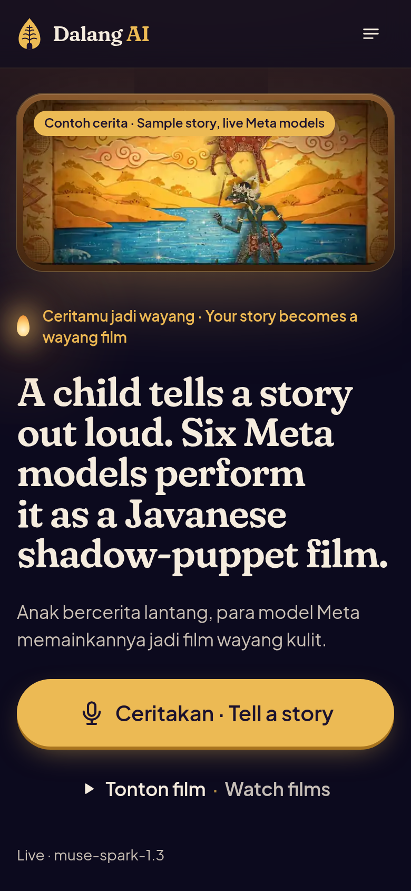
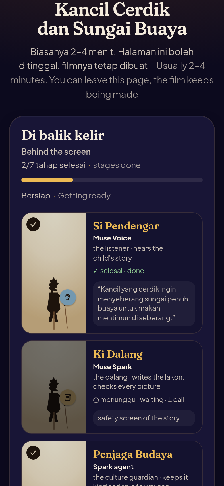
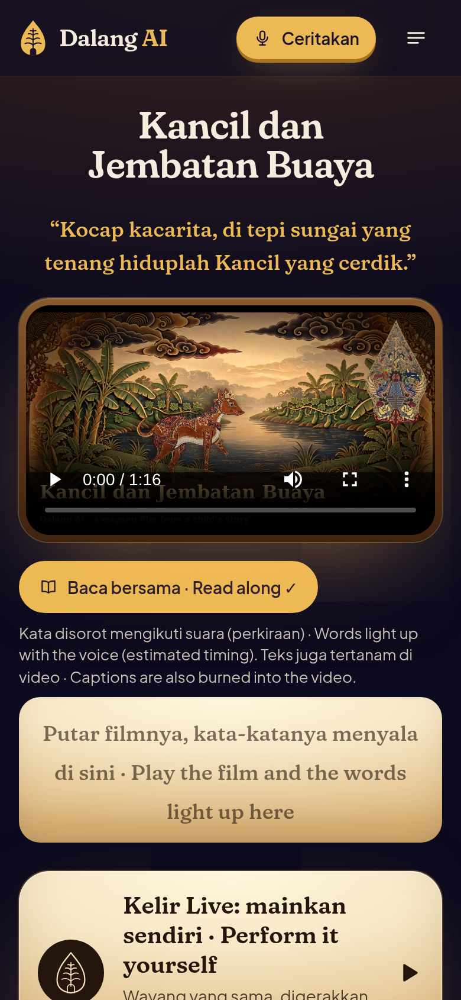
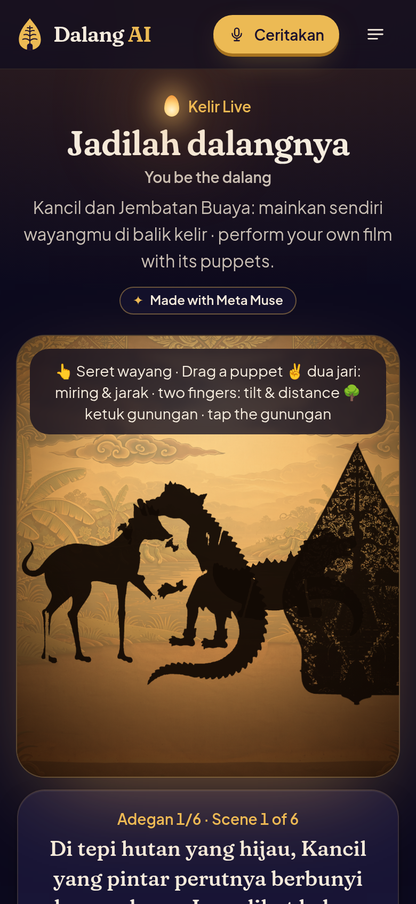

# Dalang AI (Bahasa Indonesia)

[English](README.md) · **Bahasa Indonesia**

**Seorang anak bercerita dengan suara. Enam model Meta memainkannya sebagai film wayang kulit Jawa.**

*A child tells a story out loud. Six Meta models perform it as a Javanese shadow-puppet film.*

Anak (atau orang tuanya) merekam cerita maksimal 90 detik, dalam Bahasa Indonesia, Basa Jawa, atau English.
Beberapa menit kemudian ceritanya jadi film wayang kulit 45 sampai 90 detik, dinarasikan dalam bahasa yang sama,
format 16:9 dan 9:16. Bisa disimpan, diunduh, atau dibagikan.

Saya, Ragil Artza Rozaksyah (Malik), membuatnya sendirian di Semarang untuk **Meta Global AI Developer Hackathon**
(Cerebral Valley), tema *Build for Your World*.

## Kenapa wayang

Dulu anak-anak di Jawa belajar cerita, budi pekerti, dan bahasa dari pertunjukan wayang semalam suntuk. Sekarang
pertunjukan wayang makin jarang dan banyak dalang sudah sepuh. Padahal anak-anak tetap mengarang cerita tiap hari.
Dengan Dalang AI, anak bisa melihat ceritanya sendiri dimainkan sebagai wayang, dalam bahasanya sendiri, lengkap
dengan pesan moral di akhir, lalu membagikannya ke keluarga. Anak cukup bercerita dengan suara; yang belum lancar
bicara di depan mikrofon bisa mengetik atau memilih dongeng.

## Coba dalam 5 menit

1. `git clone` repo ini.
2. macOS/Linux: `bash start.sh`. Windows: klik dua kali `start.bat`. Start pertama memasang semuanya (3 sampai 5
   menit).
3. Buka http://localhost:3000.

Galeri langsung berisi tiga film contoh yang saya buat pada 5 Nov dengan Meta Model API asli: Kancil (Bahasa
Indonesia), Timun Mas lan Buto Ijo (Basa Jawa), dan The Golden Snail Princess (English). Ceritanya saya tulis sendiri
untuk proyek ini, dan kartu judulnya bertuliskan "contoh cerita / a sample story". Gambar, potongan wayang, pemeriksaan
naskah, dan rencana gerak di film itu semuanya dari model Meta; narasinya edge-tts. Buka filmnya lalu tekan
**"Di balik kelir · Behind the screen"** untuk melihat setiap panggilan Meta yang asli, lama waktunya, dan biayanya.

Membuat film baru butuh kunci Meta (tempel di `.env`). Tanpa kunci, server bilang terus terang dan menolak membuat
film, tidak pura-pura. Kalau mau mencoba seluruh alurnya gratis, jalankan `make demo`: itu memakai *fake Meta API*
bawaan (mode uji), dan semua gambarnya diberi label "placeholder art". Kode permintaan dan pengolahannya sama dengan
yang live. Hasil pemeriksaan per model dengan API asli ada di
[docs/VERIFICATION_REPORT.md](docs/VERIFICATION_REPORT.md).

Pemeriksaan: <!-- facts:tests -->531<!-- /facts --> tes pytest (<!-- facts:coverage -->95%<!-- /facts --> cakupan
baris), uji e2e penuh (<!-- facts:e2e -->29/29<!-- /facts --> langkah), ruff, mypy, eslint, tsc, dan `next build`.
Video demo: <!-- facts:demo_length -->2:57<!-- /facts --> ([docs/demo/dalang-ai-demo.mp4](docs/demo/dalang-ai-demo.mp4)).

  
  
  
  

Semua tangkapan layar ini diambil pada 6 Nov 2026 dari aplikasi yang berjalan di Meta Model API asli. Gambarnya hasil Muse Image, tidak ada yang dipalsukan.

## Tampilan dan suara baru (2 Nov)

* **Tampilan baru** seperti pertunjukan wayang malam hari: halaman biru nila gelap, bagian terpenting di atas kelir
  krem yang menyala, tombol utama warna prada (emas), judul memakai Fraunces dan teks memakai Plus Jakarta Sans.
  Gunungan jadi logo, animasi memuat, dan gambar halaman kosong. Semua judul dua bahasa. Ada mode siang di footer.
  Rinciannya di [docs/DESIGN_SYSTEM.md](docs/DESIGN_SYSTEM.md). Audit axe: 0 pelanggaran di
  <!-- facts:a11y -->22<!-- /facts --> pemeriksaan halaman.
* **Suara narator baru.** Saya menilai suara-suara dengan UTMOS (prediksi skor MOS otomatis) lalu mengganti bawaan:
  Bahasa Inggris Kokoro-82M `af_heart` (UTMOS 3,89 jadi 4,52), Bahasa Indonesia edge-tts Emma Multilingual (3,73 jadi
  4,32), Basa Jawa tetap Siti dengan sedikit penyesuaian kecepatan dan nada. Lihat [docs/VOICES.md](docs/VOICES.md).
* **Video demo direkam ulang** di tampilan baru dengan narasi Kokoro.

## Tambahan 3 Nov: untuk HP murah dan sinyal lemah

* Saat rekaman dikirim, tombolnya menunjukkan persen unggahan. Kalau HP sedang offline, aplikasinya bilang begitu dan
  ceritanya tetap tersimpan. Halaman yang belum tersimpan menampilkan halaman offline dua bahasa dengan tombol muat
  ulang.
* Tiap masalah mikrofon (diblokir, tidak ada, sedang dipakai, halaman http, peramban lama) punya pesan ramah sendiri
  yang mengarahkan ke Unggah atau Ketik. Mikrofon mati kalau halaman ditinggal, dan rekaman di bawah 3 detik diminta
  diulang.
* Di film, tongkat wayang berhenti di atas pita teks, dan baris teks terakhir tidak pernah berisi satu kata saja.

## Tambahan 4 Nov: yang dilihat juri di server baru

* Halaman juri menunjukkan apakah server memakai fake Meta API atau API Meta asli, dan model apa saja. Tautan
  "API docs" sekarang bisa dibuka lewat website (`/api/docs`). Kalau belum ada film contoh, halamannya cukup bilang
  belum ada film contoh dan memberi tombol untuk membuat film.
* Halaman film yang salah ketik atau sudah dihapus berhenti bertanya ke server setelah dapat 404.
* Kalau server lambat menjawab (deploy baru bangun, restart), beranda bilang "belum menjawab, mencoba lagi" dan
  mencoba lagi sekitar 45 detik sebelum bilang servernya tidak jalan.
* Kalau film gagal, cerita yang diketik tetap ada di kotak cerita, jadi Coba lagi tidak mulai dari halaman kosong.
  Sejak 6 Nov rekaman suara juga disimpan di perangkat sampai filmnya jadi, jadi bisa dikirim lagi tanpa merekam ulang.
* Halaman galeri yang masih kosong sekarang dua bahasa seperti halaman lain.
* Video demo direkam ulang di tampilan sekarang, dan proses encode demo menulis ke disk lokal dulu baru menyalin
  file jadinya, supaya filenya tidak pernah setengah jadi.

## Yang bikin filmnya milik si anak

* **Mode Gara-gara.** Setelah adegan 2 atau 3, film berhenti di *gara-gara*, titik balik dalam pertunjukan wayang.
  Wayangnya bertanya "lalu apa yang terjadi?". Anak menjawab dengan suara atau memilih salah satu dari dua usulan,
  lalu Muse Spark menulis ulang sisa ceritanya.
* **Suaraku sendiri.** Narasi tiap adegan bisa diambil dari rekaman anak itu sendiri (pakai cap waktu dari Muse
  Voice Transcribe). Jadi anaknya sendiri yang jadi dalang.
* **Kotak Wayang.** Keluarga menyimpan wayang hasil potongan SAM di kotak wayang (tanpa akun) dan memakainya lagi di
  cerita berikutnya tanpa digambar ulang.
* **Wayang cetak.** Sekali ketuk keluar PDF wayang dengan garis potong dan petunjuk dalam Bahasa Indonesia dan
  English: tusuk sate, senter, kain putih. Pertunjukannya pindah dari layar ke dunia nyata.
* **Berbagi.** Film tetap pribadi sampai keluarga menekan Bagikan. Setelah itu ada tombol bagikan (lembar berbagi
  HP), salin tautan, kirim ke X dengan tagar #DalangCilik, unduh 9:16 untuk Reels/TikTok/Shorts, dan kartu pratinjau
  tautan (poster, judul, deskripsi).
* **Penjaga Budaya.** Sebelum gambar dibuat, agen Muse Spark 1.3 memeriksa tiap adegan dan wayang dengan aturan budaya
  yang saya susun (`content/cultural_rules.json`: konflik yang lembut, tanpa politik, tanpa darah, menghormati tokoh
  wayang, tokoh sesuai pakem), lalu memperbaikinya. Aturan ini belum ditinjau dalang.
* **Skor konsistensi tokoh** dari potongan SAM 3.1, dan **struk model Meta** (model, jumlah panggilan, token,
  perkiraan biaya) di bawah setiap film.
* **Mulai dari dongeng.** Delapan dongeng Nusantara (Kancil, Timun Mas, Malin Kundang, Bawang Putih, Sangkuriang,
  Keong Mas, Roro Jonggrang, Lutung Kasarung) dalam tiga bahasa, cukup pendek untuk dibacakan anak.
* **Baca bersama.** Kata yang sedang diucapkan menyala di bawah video. Teksnya juga tertanam di video.
* **Buku cerita A5** untuk dicetak, dan halaman **untuk guru** (`/guru`): sesi wayang 30 menit di kelas.
* **Mode juri** (`/judge`): panduan 60 detik.
* **Galeri contoh.** Tiga film contoh: Kancil (Bahasa Indonesia), Timun Mas lan Buto Ijo (Basa Jawa), dan The Golden
  Snail (English), dibuat dengan model Meta asli pada 5 Nov dan berlabel "contoh cerita / a sample story".

## Tambahan 1-2 Nov

* **Kelir Live** (`/kelir/{id}`): setelah filmnya jadi, anak bisa memainkannya sendiri. Wayang dari filmnya berdiri
  di kelir yang diterangi blencong. Seret wayangnya, miringkan dan dekatkan ke lampu dengan dua jari (bayangannya
  membesar dan kabur, lalu tajam lagi di kelir), ketuk dua kali untuk membalik, ketuk gunungan untuk lanjut ke adegan
  berikutnya, lihat sisi dalang yang berwarna, bunyikan keprak dan gong, lalu rekam pertunjukannya (WebM, tetap di
  perangkat). Bisa juga pakai keyboard dan slider.
* **Panggung di balik kelir**: selama film dibuat, pipeline tampil sebagai rombongan wayang enam orang (Muse
  Voice si pendengar, Muse Spark Ki Dalang, Penjaga Budaya (agen di Muse Spark 1.3), Muse Image si pelukis, SAM 3.1 si penatah, Muse Wonder
  si penggerak). Mereka menyala mengikuti jejak agen secara langsung.
* **Dalang Director** (Muse Spark 1.3) mengatur gerak kamera, keluar-masuk wayang, transisi gunungan, isyarat gamelan,
  dan efek suara di tiap adegan. Hasilnya divalidasi, dan kalau panggilannya gagal ada cadangan berbasis aturan.
* **Gamelan**: musik slendro/pelog prosedural per suasana (kode saya sendiri, tidak memakai model Meta), dan judul
  dalam aksara Jawa (Noto Sans Javanese).
* **Voting kelas**: saat gara-gara, layar kelas menampilkan tombol A/B besar dan QR. Tiap HP memberi satu suara
  (`/vote/{id}`), batang hitungannya naik langsung, lalu guru menutup voting dan cerita lanjut dengan pilihan yang
  menang.
* **Remix**: wayang yang sama, cerita baru, dalam bahasa lain atau dari sisi tokoh jahat (satu panggilan Muse Spark).
* **Berbagi**: paket stiker WhatsApp (WebP 512x512 transparan, di bawah 100 KB), GIF berulang, kartu berbagi
  1080x1350, dan **/pentas**, dinding film yang sudah dibagikan, diurutkan menurut Sembah.
* **Jaring pengaman go-live**: uji kontrak terhadap bentuk API Meta yang terdokumentasi, `make preflight` (satu
  panggilan termurah per model, sekitar $0,02), batas biaya, dan gambar berlabel "placeholder" kalau Muse Image tetap gagal setelah dicoba ulang,
  supaya filmnya tidak ikut gagal ([docs/GO_LIVE.md](docs/GO_LIVE.md)).

## Enam model Meta dan tugasnya

| Tahap | Yang terjadi | Model |
|---|---|---|
| Mendengar | Rekaman ditranskripsi lalu langsung dihapus; cerita disaring agar aman untuk anak | Muse Voice Transcribe (Basa Jawa lewat Muse Spark audio, karena Basa Jawa belum didukung Voice Transcribe) |
| Menulis lakon | Transkrip menjadi naskah terstruktur (JSON tervalidasi): judul, pesan moral, tokoh, 4-6 adegan | Muse Spark (atau Muse Spark Open, *open weights*) |
| Memilih wayang | Satu lembar wayang per tokoh, lalu dipotong menjadi PNG transparan dan dipakai di semua adegan | Muse Image + SAM 3.1 |
| Memeriksa | Setiap gambar dicek terhadap naskah; yang salah digambar ulang (loop agen) | Muse Spark vision |
| Menggerakkan | Rencana gerak berupa keyframe, dimainkan oleh mesin kelir buatan saya dengan nyala blencong dan bayangan | Muse Wonder |
| Narasi dan potongan akhir | Suara narator, gamelan sintetis, subtitle, gunungan, 16:9 dan 9:16 | edge-tts Emma Multilingual (Bahasa Indonesia), edge-tts Siti (Basa Jawa), Kokoro-82M `af_heart` untuk Bahasa Inggris kalau dipasang, + ffmpeg (Meta belum punya model TTS; pilihan suaranya ada di [docs/VOICES.md](docs/VOICES.md)) |

Beberapa hal yang perlu diketahui: Muse Wonder menghasilkan teks (rencana gerak), bukan video. Meta Model API tidak
punya model text-to-speech. Muse Spark Open dan Muse Glimmer hanya tersedia lewat penyedia hosting. Rinciannya ada di
[docs/META_MODELS.md](docs/META_MODELS.md) dan [docs/OPEN_WEIGHTS.md](docs/OPEN_WEIGHTS.md).

## Privasi dan keamanan anak

* Rekaman dihapus setelah ditranskripsi (atau setelah film jadi, kalau memakai "suaraku sendiri").
* Tidak ada nama, sekolah, atau wajah yang dikumpulkan.
* Cerita yang mengandung kekerasan, konten seksual, politik, perang, atau medis ditolak dengan ramah.
* Film baru muncul di galeri publik kalau keluarga menekan Bagikan.
* Rekaman mentah dan berkas JSON pekerjaan tidak pernah bisa diunduh dari `/media`, walaupun orang tahu id filmnya.
* Ada batas biaya per film dan batas penyalahgunaan untuk tautan publik. Sembah dihitung sekali per pengunjung per
  film.

## Mana yang asli, mana yang contoh

* Tiga film contoh di galeri, video pendek di beranda, gambar untuk berbagi, dan `docs/screenshots/demo.gif`: dibuat
  dengan Meta Model API asli pada 5 Nov 2026. Ceritanya contoh yang saya tulis untuk proyek ini.
* Narasi: edge-tts / Kokoro (Meta belum punya model TTS).
* `assets/sample-story/sample_story_synthetic.mp3`: suara sintetis (edge-tts, id-ID-GadisNeural, nada normal). Bukan
  suara anak dan bukan orang sungguhan.
* Video demo, teaser, klip peluncuran dan tangkapan layar di `docs/`: direkam pada 6 Nov 2026 dengan Meta Model API
  asli. Narator video demo adalah suara sintetis (Kokoro-82M), dan suara anak di 3 detik pertama adalah pengganti
  sintetis yang diberi label.
* Uji coba dengan keluarga dan tinjauan budaya oleh dalang belum dilakukan (`docs/USER_TESTING.md`: "Real sessions:
  0"). Karena itu situs tidak menampilkan testimoni apa pun.
* Aplikasinya belum di-deploy, jadi belum ada tautan publik atau kode QR di repo. Sampai `PUBLIC_BASE_URL` diisi, QR
  di situs memakai alamat yang sedang dibuka pengunjung.

## Go live

1. Tempel kunci Meta Model API di `.env` setelah `META_API_KEY=`.
2. `python scripts/go_live.py --preflight`: satu panggilan termurah per model (sekitar $0,02). Semua baris harus
   **PASS**; pada 5 Nov hasil saya 6/6 PASS.
3. Jalankan ulang aplikasinya. Kalau render gagal dengan I/O error di drive jaringan, isi `ENCODE_DIR` dengan folder
   lokal.

## Ikut berkontribusi

Koreksi budaya dari dalang, sanggar, atau penutur Basa Jawa sangat saya harapkan. Lihat
[CONTRIBUTING.md](CONTRIBUTING.md), [docs/CULTURAL_REVIEW.md](docs/CULTURAL_REVIEW.md), dan
[CODE_OF_CONDUCT.md](CODE_OF_CONDUCT.md).

## Lisensi

Kode: MIT, lihat [LICENSE](LICENSE). File pihak ketiga di repo ini hanya tiga font berlisensi SIL Open Font License
1.1: Noto Sans Javanese (`content/fonts/OFL.txt`), serta Fraunces dan Plus Jakarta Sans (`web/app/fonts/OFL-*.txt`). Tidak ada gambar atau musik pihak ketiga; gamelan disintesis
di dalam kode. Rincian aset ada di bagian *Assets and licences* di [README.md](README.md#assets-and-licences).
