# Dalang AI

**English** · [Bahasa Indonesia](README.id.md)

**A child tells a story out loud. Six Meta models perform it as a Javanese shadow-puppet film.**

A kid (or a parent) records a story of up to 90 seconds in Bahasa Indonesia, Basa Jawa or English. A few minutes
later they get a 45 to 90 second wayang film narrated in that language, in 16:9 and 9:16, to keep, download or share.

I built it solo in Semarang for the Meta Global AI Developer Hackathon (Cerebral Valley), theme *Build for Your
World*, indie track, Oct 26 to Nov 4, 2026. Wayang kulit is still part of life here in Central Java, and I wanted
kids to see their own stories on the kelir.

> **Judges: what you can see without a key.** Clone the repo, run `bash start.sh` (macOS/Linux) or double-click
> `start.bat` (Windows), and open http://localhost:3000. The first start installs everything (about 3 to 5 minutes).
> The gallery already has three sample films I made on Nov 5 with the live Meta Model API: Kancil in Bahasa Indonesia,
> Timun Mas in Basa Jawa and The Golden Snail Princess in English. Their stories were written by me for this project
> and are labelled "contoh cerita / a sample story" on the title card. Every picture, cut-out, script check and motion
> plan in them came from the real models; the narration is edge-tts. Open a film and press
> **"Di balik kelir · Behind the screen"** to see each real Meta call, its latency and cost.
>
> Making a new film needs a Meta key (paste it in `.env`, see [Go live](#go-live-with-one-command)). Without one the
> server says so and refuses the film rather than pretending. To click through the whole flow for free, run
> `make demo`: it starts the built-in fake Meta API (test mode), and everything it draws is labelled
> "placeholder art". The request and parsing code is the same as live.
>
> http://localhost:3000/judge is a 60-second guide: a sample film, the Penjaga Budaya cultural review, the
> character-consistency score, the Meta models receipt and the agent trace on one page. The API documents itself at
> http://localhost:8000/docs, and `make help` lists every command. What I checked against the real API, per model:
> [docs/VERIFICATION_REPORT.md](docs/VERIFICATION_REPORT.md).
>
> Checks: <!-- facts:tests -->558<!-- /facts --> pytest tests (<!-- facts:coverage -->95%<!-- /facts --> line coverage), a full-stack e2e smoke test
> (<!-- facts:e2e -->29/29<!-- /facts --> steps), 25 browser checks of the newest screens on a 390 px phone (`web/e2e/r5_ui.py`: Kelir Live drag/tilt/gunungan/keyboard, classroom vote, remix, stickers, /pentas, PWA offline), ruff, mypy, eslint, tsc and `next build`. `make check` runs them all
> ([docs/TEST_REPORT.md](docs/TEST_REPORT.md)). There's also an axe-core accessibility audit (<!-- facts:a11y -->33<!-- /facts --> page checks incl. /kelir, /vote and /pentas, phone and desktop, 0 violations,
> [docs/ACCESSIBILITY.md](docs/ACCESSIBILITY.md)) and a 6-films-at-once concurrency test (`scripts/load_local.sh`). Demo video: <!-- facts:demo_length -->2:58<!-- /facts -->.
>
> How the six Meta models fit together (structured output, the verify -> redraw agent loop, SAM reuse, Muse Wonder
> keyframes, open weights, a real agent trace): [docs/META_MODELS.md](docs/META_MODELS.md).

<p align="center">
  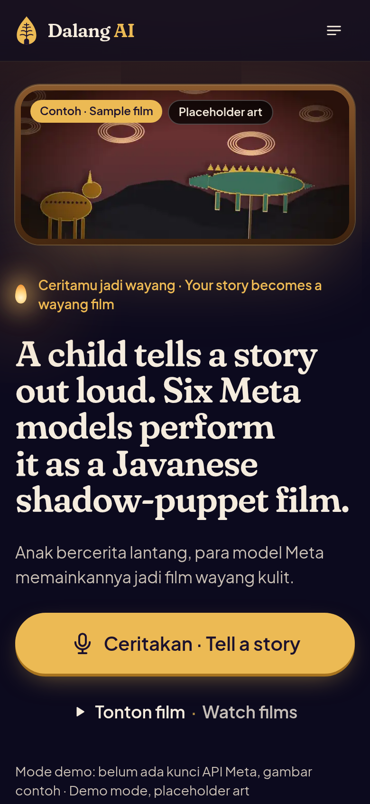
  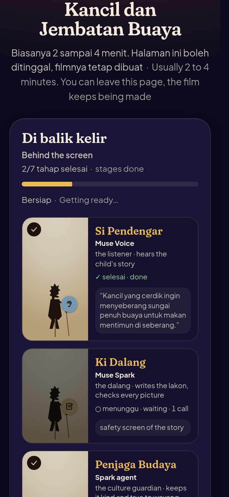
  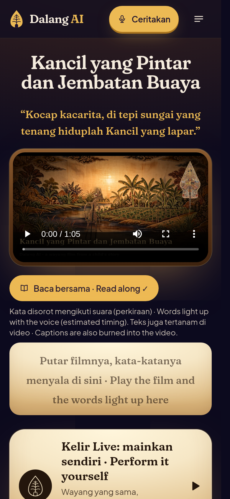
  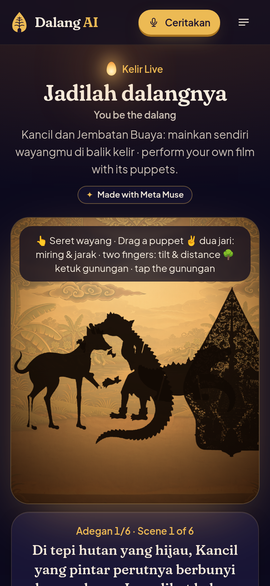
</p>
<p align="center">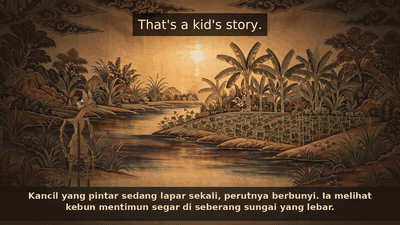</p>
<p align="center">
  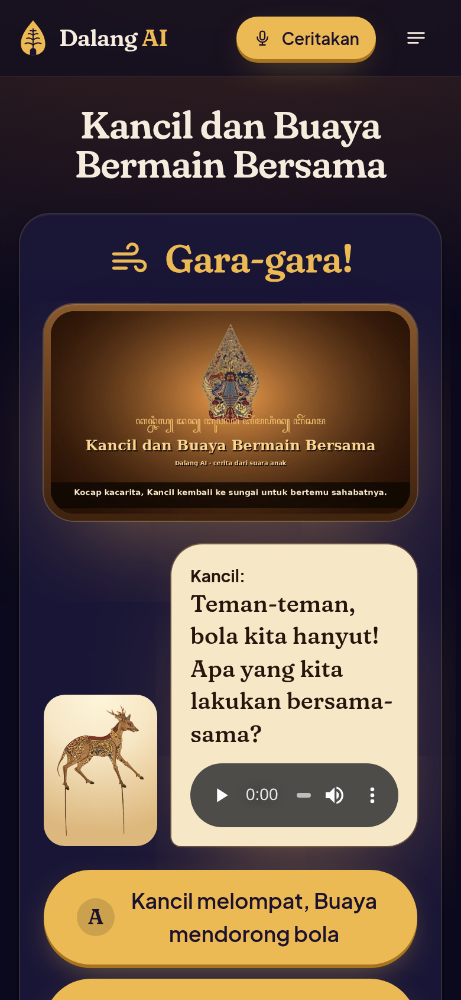
  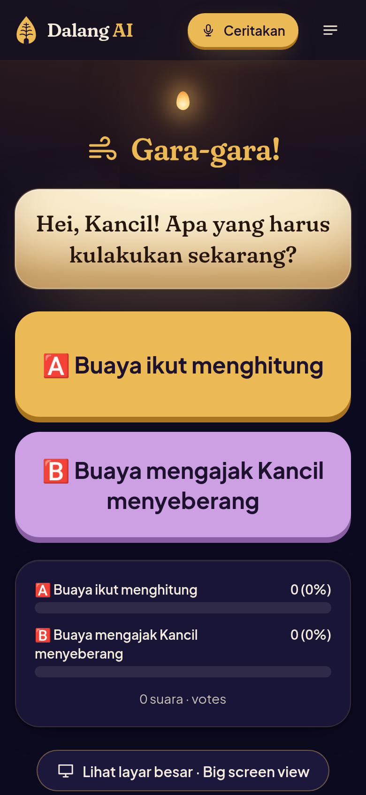
  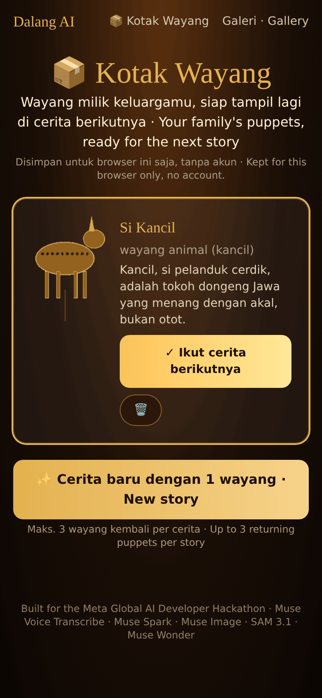
  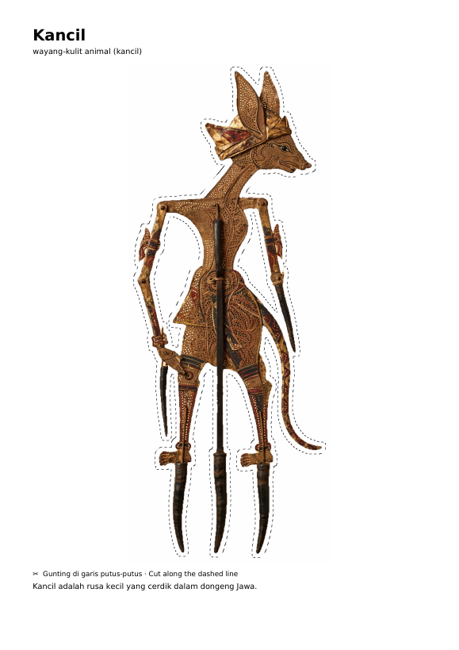
</p>
<p align="center">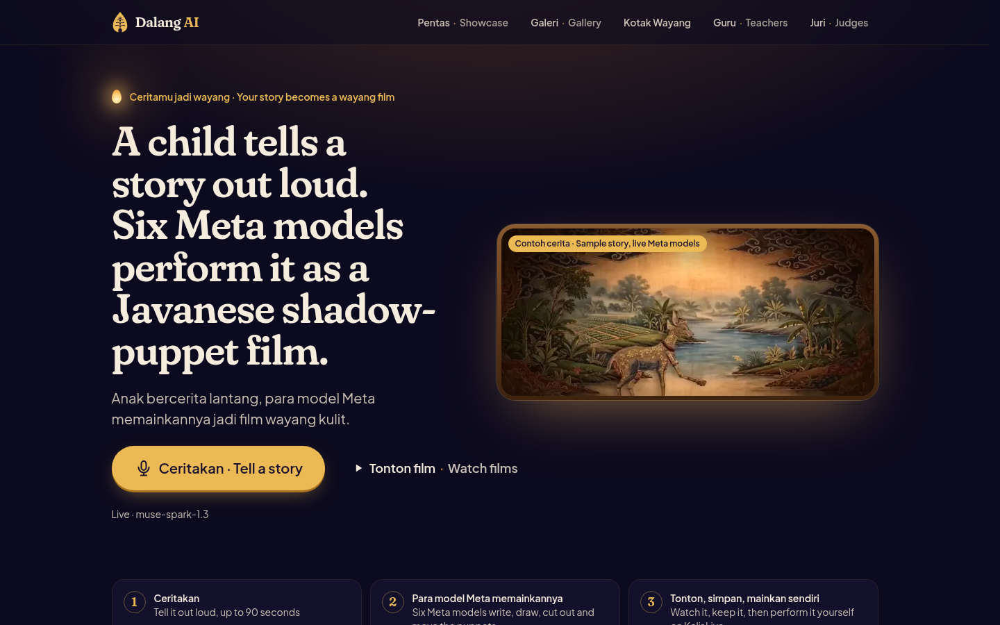</p>
<p align="center">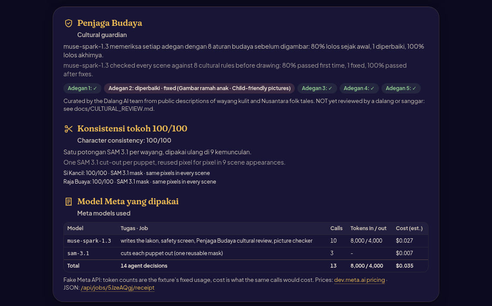</p>
<p align="center">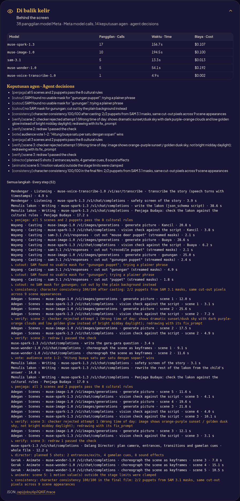</p>
<p align="center"><sub>Every screenshot here was taken on Nov 6, 2026 from the app running on the live Meta Model API. The art is Muse Image output; nothing is mocked.</sub></p>
<p align="center"><b>Demo video (under 3:00, voice-over and captions):</b> <a href="docs/demo/dalang-ai-demo.mp4">docs/demo/dalang-ai-demo.mp4</a></p>
<p align="center"><sub>The clip above is from the Kancil sample film, made with the live Meta models. The demo video, its
teasers and the UI screenshots were recorded on Nov 6, 2026 on the live Meta Model API too. The narrator in the demo
is a synthetic voice (Pocket TTS), the child's voice in its first 3 seconds is a labelled synthetic stand-in, and the
four photo-style scenes of families and a classroom are AI-generated and labelled on screen.</sub></p>

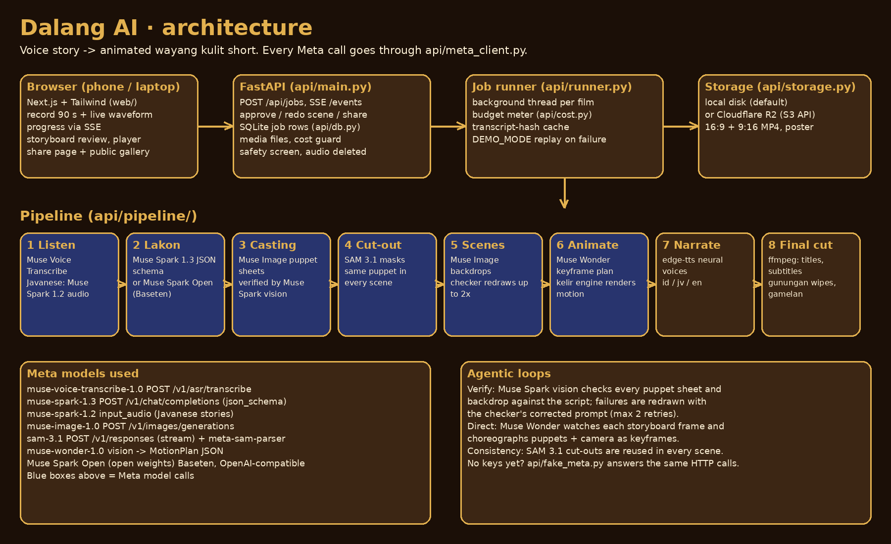

## What makes it the child's own

* **Gara-gara mode.** After scene 2 (or 3) the film stops at the *gara-gara*, the turning point of a wayang night.
  A puppet asks the child a question Muse Spark wrote. The child answers by voice or taps one of two suggestions,
  Muse Spark rewrites the remaining scenes in the validated lakon schema, and only those scenes get painted,
  choreographed and narrated again (`POST /api/jobs/{id}/choice`).
* **My own voice.** With `narration_voice=child`, each scene's narration is cut from the child's recording using
  Muse Voice Transcribe's speech-turn timestamps (`startMs`/`endMs`), and the subtitles show the child's words. The
  recording is kept only until the film is made, then deleted. Javanese (Muse Spark audio gives no timestamps) or a
  recording with too few turns falls back to the Ki Dalang voice.
* **Kotak Wayang.** A family keeps its SAM cut-outs in a puppet box (a random family id in the browser, no account)
  and brings them back in the next story. Returning puppets skip Muse Image and SAM (`/kotak`, `/api/kotak`).
* **Printable puppets.** `GET /api/jobs/{id}/puppets.pdf` gives an A4 sheet: every puppet large with a dashed cut
  line, its name and cultural note, and "skewer, torch, white sheet" instructions in Bahasa and English.
* **Agent trace ("Di balik kelir").** Each film records every Meta model call (model, purpose, endpoint, latency,
  attempts) and every agent decision: a checker rejecting a picture and the redraw, a script retried after Pydantic
  validation, a cache hit, a SAM or Muse Wonder fallback. You see it under the storyboard and the film, with calls
  and cost per model, and at `GET /api/jobs/{id}/trace`.
* **Penjaga Budaya (cultural guardian).** Between the lakon and the drawing, a Muse Spark 1.3 agent checks every
  scene and puppet against a small rules file I wrote (`content/cultural_rules.json`: gentle conflict, no politics,
  no gore, respect for wayang figures, child-friendly pictures, character canon for Kancil, Semar, Timun Mas and
  others, no invented ritual, respect for the gunungan). It writes its fixes into the script before Muse Image draws
  anything, and a word scan of the same rules runs before and after as a backstop. Findings and fixes show up as
  agent decisions in the trace. The rules are mine and **not yet reviewed by a dalang** (`docs/CULTURAL_REVIEW.md`).
* **Character consistency score.** Each film scores its puppets 0-100 from the SAM 3.1 cut-outs: mask source (SAM or
  background fallback), mask quality, checker redraws, and a SHA-256 check that the same cut-out pixels were used in
  every scene (`api/pipeline/consistency.py`).
* **Meta models receipt.** Under every film: each Meta model, what it did, calls, tokens and estimated cost from
  Meta's list prices (`GET /api/jobs/{id}/receipt`, also inside `/trace`).
* **Story Starters.** Eight public-domain Nusantara tales (Kancil, Timun Mas, Malin Kundang, Bawang Putih,
  Sangkuriang, Keong Mas, Roro Jonggrang, Lutung Kasarung), each a short prompt in Bahasa Indonesia, Basa Jawa and
  English that a child can read aloud. One tap fills in the story (`web/lib/starters.json`). The Javanese lines still
  need a native-speaker check.
* **Read along.** Karaoke captions under the player light up each word as it's spoken (timing estimated from the
  WebVTT cues), for early readers. Captions are also burned into both MP4s for deaf and hard-of-hearing viewers.
* **Storybook.** `GET /api/jobs/{id}/storybook.pdf` is an A5 book, one page per scene with its picture and the
  narration in big type, for reading together.
* **For teachers.** `/guru` is a 30-minute classroom wayang session: watch, meet the wayang, tell, read along, then
  print and play shadows.
* **Evaluation script.** `make eval` runs 6 golden stories (2 per language) and writes
  [docs/EVAL_REPORT.md](docs/EVAL_REPORT.md) (scene count, narration bounds, language match, cultural-rule pass rate,
  consistency). On the fake API it tests my code, not Meta's model quality; the live per-model results are in
  [docs/VERIFICATION_REPORT.md](docs/VERIFICATION_REPORT.md).
* **Family testing kit.** A 1-5 smiles widget under every film (`/api/feedback`, `/api/feedback/summary`), a session
  script and consent note (`docs/USER_TESTING.md`), and a cultural-review checklist for a dalang or sanggar
  (`docs/CULTURAL_REVIEW.md`). No family sessions have happened yet, so the site shows no testimonials.

## Added Nov 1-2

* **Kelir Live** (`/kelir/{id}`): after the film, the child gets to perform it. The film's puppets stand on a
  blencong-lit kelir. Drag one (pointer events), tilt it and pull it toward the lamp with two fingers (the shadow grows
  and softens, then sharpens again on the screen), double-tap to turn it, tap the gunungan for the next scene with its
  narration as a prompt, flip to the dalang's colour side, play keprak and gong, and record the show (canvas + mic,
  WebM, kept on the device). Keyboard and sliders do the same for kids who can't drag.
* **Pipeline theatre**: while a film is being made, the pipeline plays as a six-member wayang troupe on stage (Muse
  Voice the listener, Muse Spark the dalang, Penjaga Budaya the guardian (an agent on Muse Spark 1.3), Muse Image the painter, SAM 3.1 the
  carver, Muse Wonder the puppeteer), lit by the live agent trace over SSE.
* **Dalang Director** (Muse Spark 1.3) directs the whole film shot by shot: camera moves, entrances and exits,
  gunungan transitions, gamelan cues, sound effects. The plan is validated and repaired, with a rule-based fallback if
  the call fails.
* **Gamelan score**: a real gamelan recording under every film (court musicians of the Kraton Ngayogyakarta, recorded
  by RTB45, CC BY 4.0, calm or lively excerpt per scene mood), or procedural slendro/pelog music per mood in my own
  code with `GAMELAN_SOURCE=procedural` (no Meta model involved either way), plus the title in
  aksara Jawa (Noto Sans Javanese).
* **Classroom vote**: at the gara-gara the class screen shows big A/B buttons and a QR. Every phone casts one vote
  (`/vote/{id}`), the bars grow live, and the teacher closes the vote so the film carries on with the winner.
* **Remix**: same puppets, new telling, in another language or from the villain's side. It's one Muse Spark call,
  about 6% of the original film's estimated cost in my fake-API eval.
* **Share**: a WhatsApp sticker pack (512x512 transparent WebP under 100 KB, cut from the SAM masks), a looping GIF,
  a 1080x1350 share card drawn in the browser, and **/pentas**, a wall of shared films sorted by Sembah.
* **Home**: the Kancil sample film loops muted as the hero (labelled as a sample story), there's one big *Ceritakan ·
  Tell a story* button, and the Story Starter cards are cast as shadows. The site works as a PWA (`/pentas`,
  `/gallery`, `/watch` open offline).
* **Go-live safety net**: contract tests against Meta's documented shapes, `make preflight` (one cheapest call per
  model, about $0.02), retries with a circuit breaker, a picture labelled "placeholder" if Muse Image still fails after retries,
  hard spend caps, record/replay fixtures ([docs/GO_LIVE.md](docs/GO_LIVE.md), [docs/META_MODELS.md](docs/META_MODELS.md)).

<p align="center">
  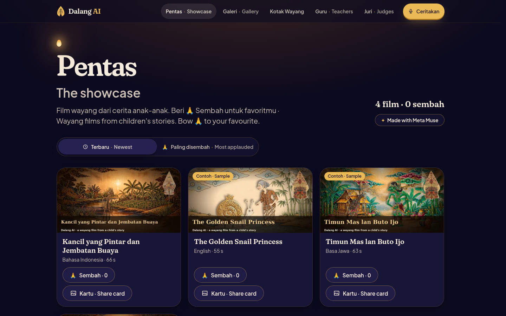
</p>
## Added Nov 2: a new look and new voices

* **The site was redesigned** as a night show: a night-indigo page, the things that matter on a lit cream kelir,
  gold (prada) for the main buttons, Fraunces for headings and Plus Jakarta Sans for text. The gunungan is the logo,
  the loader and the empty-state picture. Every heading is bilingual (Bahasa Indonesia first, English after). There
  is a day theme in the footer. Tokens, components and the reasoning are in
  [docs/DESIGN_SYSTEM.md](docs/DESIGN_SYSTEM.md). The axe audit has 0 violations on all
  <!-- facts:a11y -->33<!-- /facts --> page checks, and the home page's largest paint stays under the 1.5 s target on a
  local production build (1.1 s and 0.45 s on two runs; the machine's load moves it, see
  [docs/WEB_PERF_R5.md](docs/WEB_PERF_R5.md)).
* **New narrator voices.** I ran a listening test with an automatic MOS predictor (UTMOS) and changed the defaults:
  English is Kokoro-82M `af_heart` (UTMOS 3.89 to 4.52), Indonesian is edge-tts Emma Multilingual (3.73 to 4.32),
  Javanese stays on Siti with a small rate and pitch tweak. The scores, how to switch and the licences are in
  [docs/VOICES.md](docs/VOICES.md).
* **The demo video was re-recorded** on the new site with the Kokoro voice-over
  (<!-- facts:demo_length -->2:58<!-- /facts -->), with 60 s and 42 s teasers. I re-recorded it again on Nov 4
  (see below).

## Added Nov 3: for cheap phones and weak signal

* The home page shows upload progress in percent while a recording is sent, and if the phone goes offline it says so
  and keeps the story. Pages that aren't cached open a bilingual offline page with a reload button.
* Each microphone problem (blocked, none found, busy, an http page, an old browser) gets its own kind message that
  points at Unggah (upload) or Ketik (type). Leaving the page while recording turns the mic off, and a recording
  under 3 seconds asks to try again.
* Kelir Live draws the idle lamp flicker at about 30 fps and nothing while it's scrolled off screen. The film page
  stops polling once the film is done. The hero loop isn't downloaded on Data Saver, 2G or 3G.
* In the films, puppet rods stop at the caption band, and the last caption line never holds a single word.
* The errors a family can actually see (no story, no gara-gara answer, wrong language) are bilingual.
* Safety: see [Privacy and safety](#privacy-and-safety) (raw recordings never served, one Sembah per visitor, security
  headers).

## Added Nov 4: what a judge sees on a fresh deploy

* The judge page says whether the server runs the fake Meta API or the live one, and which models. Its "API docs"
  link now works through the website (`/api/docs`). With no sample film yet it shows a plain "no sample film yet"
  message and a Make a film button.
* A film page for a mistyped or deleted film stops asking the server once it gets the 404.
* If the server is slow to answer (a deploy waking up, a restart), the home page says "not answering yet, trying
  again" and retries for about 45 seconds before it says the server isn't running.
* When a film fails, the typed story stays in the story box, so Try again doesn't start from an empty page. Since
  Nov 6 a recording is kept on the device too, until the film is done, so it can be sent again without re-recording.
* The gallery's empty state is bilingual like the rest of the site.
* The demo video was re-recorded on the current site, and the demo encoder now writes to a local disk first and
  copies the finished file over, so the file can't end up half-written.

## Added Nov 6: polish pass

- Pages don't jump while they load any more. The film page used to push its footer down once it filled in; now
  every page stays put (layout shift under 0.1 everywhere, from 0.78 at worst).
- Gallery and Pentas load about half as much on a phone: the cards use small WebP posters made once per film.
- Buttons and links a thumb needs are at least 44 px tall.
- Day mode turns the phone's browser bar light too, and the accessibility audit now checks day mode as well.
- Every doc and code comment reads in my own words now; `scripts/voice_check.py` flags AI-sounding wording and
  fails the tests if it comes back.

## Added Nov 6: a smoother site

- Pages change like scenes behind the gunungan: the old one dims out, the new one rises in, the header stays put.
- A poster you tap in the gallery or on the Pentas wall grows into the film player.
- Gallery and Pentas show card-shaped placeholders while films load, instead of a blank wait.
- The recorder answers in sound and touch, so kids who can't read yet know it's listening: a soft bonang note and a
  short buzz on start, a lower note on stop, a gold ring that fills over the 90 seconds, and an accidental double tap
  no longer cuts the story off.
- Everything that moves turns off with the phone's reduced-motion setting. Details in `docs/DESIGN_SYSTEM.md`.

## Added Nov 6: final checks

* A recording sent for a film that then failed stays in the browser (IndexedDB) until a film is done, for at most
  6 hours, so the family can press Make my wayang again without telling the story again.
* A self-hosted `next start` now gzips its pages and JavaScript. The progress stream opts out with
  `Cache-Control: no-transform`, so it still arrives step by step (the e2e run checks both).
* The judge page says the checker uses "the cultural rules built into the app". The docs no longer point at the
  removed testimonials file or a made-up link, and the tutorial says what really happens without a key.
* A headless browser went through every page at 375 px and 1440 px on the fake API: no console errors, failed requests,
  overflow or broken links.
* The demo video (2:57), both teasers, the three X launch clips, the YouTube thumbnail and every screenshot were
  re-recorded on the live Meta Model API. The demo has a quiet gamelan bed under the app shots now, so there's no dead
  air, and its close card names the public repo instead of a "planned" line.
* Muse Wonder once returned a keyframe angle just past the stage limit, and the whole scene's motion plan was thrown
  away for a rule-based glide. Out-of-range numbers are now clamped to the limit, the model's plan is kept, and the
  trace says how many values were clamped.

## Why

Wayang kulit is UNESCO-listed heritage (proclaimed 2003) and Javanese has about 68 million native speakers. Still,
from what I see around me, a kid today is far more likely to meet a cartoon than a wayang show. Kids still make up
stories every day, though. Dalang AI lets them see their own story performed as wayang, in their own language, with
a moral at the end, and share it with family. It's a creative tool. You don't chat with it.

## How it works (the nine stages)

| # | Stage (shown in the app) | What happens | Model |
|---|---|---|---|
| 1 | Listening | Audio is converted to 16 kHz mono WAV and transcribed, then the recording is deleted. A safety screen blocks violence, sexual, political, war and medical content. | **Muse Voice Transcribe** (`muse-voice-transcribe-1.0`). Javanese audio goes to **Muse Spark 1.2** audio understanding, since Javanese isn't one of Voice Transcribe's 25 languages |
| 2 | Writing the lakon | The transcript becomes a structured script: title, moral, 1 to 4 characters mapped to wayang archetypes, 4 to 6 scenes with narration, image and motion prompts. Validated with Pydantic, retried once. | **Muse Spark 1.3** (`response_format: json_schema`), or **Muse Spark Open** (open weights, on Baseten) with `USE_OPEN_WEIGHTS=true` |
| 3 | Casting the puppets | One canonical puppet sheet per character, side profile, plain background. | **Muse Image** (`muse-image-1.0`) |
| 4 | (cut-out) | Each puppet is cut out as a transparent PNG and reused in every scene, so characters look the same throughout. | **SAM 3.1** (`sam-3.1`, parsed with Meta's `meta-sam-parser`) |
| 5 | Painting the scenes | An empty kelir backdrop per scene. Puppets are composited on their marks to make the storyboard. | **Muse Image** |
| 8 | (verify, agentic) | Every puppet sheet and backdrop is checked against the script. Failures are redrawn with the checker's corrected prompt, up to 2 times. | **Muse Spark 1.3** vision |
| 6 | Bringing them to life | The dalang's hands: looks at each storyboard frame and returns a keyframe motion plan (glide in, hop, bow, tremble, camera move, lamp flicker). The kelir engine performs it. | **Muse Wonder** (`muse-wonder-1.0`) |
| 7 | Narrating | A narrator voice per language, picked in a listening test ([docs/VOICES.md](docs/VOICES.md)). | Kokoro-82M for English when installed, `edge-tts` for the rest (Meta's Model API has no text-to-speech model) |
| 9 | Final cut | Title card, gunungan wipes between scenes, subtitles, a gamelan bed (a real Kraton recording, CC BY 4.0) that ducks under the narration, 16:9 and 9:16 MP4, and a 1200x630 share poster. | ffmpeg |

Where it differs from what you might expect (checked against Meta's docs on 2026-10-30):
* **Muse Wonder outputs text, not video.** Meta's Model API has no video model, so Muse Wonder plans the motion
  (structured keyframes) and my renderer (`api/pipeline/engine.py`) animates it.
* **There's no Meta TTS**, so narration comes from `api/tts.py`. On Nov 2 I scored the candidates
  ([docs/VOICES.md](docs/VOICES.md)) and swapped the defaults: English is Kokoro-82M `af_heart` (open, Apache-2.0,
  runs on a CPU) when `requirements-tts.txt` is installed, otherwise edge-tts `en-US-EmmaMultilingualNeural`;
  Indonesian is edge-tts `en-US-EmmaMultilingualNeural`; Javanese stays on `jv-ID-SitiNeural`. `TTS_ENGINE=edge`
  goes back to edge-tts only.
* **Muse Spark Open** is only on hosted providers. Meta's docs give the Baseten model id `meta-models/muse-spark-open`.
  Set `OPEN_MODEL` if your Baseten dashboard shows a dated id.
* **Muse Glimmer** (open weights, 30B) isn't on Meta's Model API. With `USE_OPEN_WEIGHTS=true` the safety screen and
  the title/moral polish run on it through Together AI (`meta-models/Muse-Glimmer-30B`, the hosted provider Meta's
  docs name) or a self-hosted OpenAI-compatible server. Details: [docs/OPEN_WEIGHTS.md](docs/OPEN_WEIGHTS.md).

## Run it

`bash start.sh` (or `start.bat`) starts the API on port 8000 and the website on port 3000. What you get depends on
`.env`:

* **No key yet:** the three sample films in `content/samples/` load into the gallery on first start
  (`BUNDLED_SAMPLES=false` skips them). New films are refused with a plain message until a key is set.
* **`META_API_KEY` set:** every film is made by the live Meta models.
* **`FAKE_META=1`** (or `make demo`): the built-in fake Meta API (`api/fake_meta.py`) answers every call with
  canned replies and labelled placeholder art. Tests run this way. It is never switched on by a missing key.

You need **Python 3.10+**, **Node.js 20+**, and internet for the narration voice. The nicer English voice
(Kokoro) is optional: `pip install -r requirements-tts.txt` (about 1 GB), or put it in its own venv and set
`TTS_PYTHON=/path/to/that/venv/bin/python`. Without it, English falls back to edge-tts by itself. `TTS_ENGINE` picks
the engine (`auto` by default); the details are in [docs/VOICES.md](docs/VOICES.md).

* Windows: double-click **`start.bat`**
* macOS / Linux: `bash start.sh`

Then open **http://localhost:3000**. The website proxies `/api` to the backend on port 8000. If you move the backend,
set `API_ORIGIN` before `npm run build`. Step-by-step for beginners: [docs/TUTORIAL.md](docs/TUTORIAL.md).

## Go live with one command

1. Open `.env` (created from `.env.example` on first start) and paste your Meta Model API key after `META_API_KEY=`.
2. Run `python scripts/go_live.py --preflight`. It makes the cheapest call per model (about $0.02) and every line
   should say **PASS**. On Nov 5 it was 6/6 PASS for me.
3. Restart the app. The header says "Live" and the judge page lists the models.

`python scripts/go_live.py` without `--preflight` also re-renders the demo film, clips and screenshots on the live
models; `--dry-run` rehearses it for free on the fake API. Add `--audio my_story.m4a` to use your own recording
instead of the synthetic sample voice in `assets/sample-story/`. If renders fail with an I/O error on a network
drive, set `ENCODE_DIR` to a local folder. Open weights are optional: `USE_OPEN_WEIGHTS=true` plus
`BASETEN_API_KEY=` (Muse Spark Open) and/or `GLIMMER_API_KEY=` (Together AI, Muse Glimmer).

## Live link and QR code

The app isn't deployed yet, so there is no public link or QR code in this repo. Until `PUBLIC_BASE_URL` is set, the
QR on the landing page and share cards points at whatever address the visitor opened the site on. After deploying,
set `PUBLIC_BASE_URL` (Render, Vercel and `.env`) and run `python scripts/make_qr.py` to write `docs/qr.png`.
`GET /api/qr.png?path=/watch/<id>` serves one for any page.

## Real and sample content

| What | Where it comes from |
|---|---|
| The 3 sample films in the gallery, the home page loop, share images, `docs/screenshots/demo.gif` | Live Meta Model API, Nov 5, 2026. Stories written by me for this project, labelled "contoh cerita / a sample story" |
| Narration in every film | edge-tts / Kokoro voices (Meta has no text-to-speech model) |
| `assets/sample-story/sample_story_synthetic.mp3` | A synthetic voice (edge-tts, id-ID-GadisNeural, normal pitch). Not a child, not a real person |
| Demo video, teasers, launch clips and UI screenshots in `docs/` | Live Meta Model API, Nov 6, 2026. The demo's narrator is a synthetic voice (Pocket TTS, `caro_davy`), its opening child's voice is a labelled synthetic stand-in, and its four photo-style scenes of people are AI-generated and labelled "AI-generated scene" ([docs/demo/broll](docs/demo/broll/README.md)). The three classroom "phones" in the vote shot are API calls from the recording script |
| Anything made with `FAKE_META=1` or `make demo` | Fake Meta API, labelled "placeholder art" |
| Family testing, cultural review | Not done yet: `docs/USER_TESTING.md` says "Real sessions: 0", `docs/CULTURAL_REVIEW.md` says "not reviewed yet" |

## Repo layout

```
api/                 FastAPI backend
  main.py            HTTP routes + Server-Sent Events
  meta_client.py     the only module that calls Meta (and Baseten / Together AI for open weights)
  fake_meta.py       fake Meta API for test mode (FAKE_META=1)
  schemas.py         Pydantic models for the script, checks and motion plans
  prompts.py         all prompts and JSON schemas (also in docs/prompts.md)
  kotak.py           Kotak Wayang (family puppet box)
  printable.py       printable puppets PDF
  qr.py              QR codes (PUBLIC_BASE_URL, or the visitor's own address until it's set)
  samples.py, sample_stories.py   bundled sample films (import on start) and the stories I wrote for them
  logs.py            structured logs with a request id, secrets scrubbed
  runner.py, jobs.py, db.py, cost.py, storage.py
  pipeline/          listen, lakon, casting, segment, scenes, garagara, animate, narrate, verify, cut, engine
web/                 Next.js App Router + Tailwind (home, film, watch, kelir, vote, pentas, gallery, kotak, guru, judge)
  components/ui/     design-system components (Button, Badge, Sheet, Progress, Tabs, Toast, Icon, Gunungan, Bi)
  app/fonts/         Fraunces + Plus Jakarta Sans (OFL), loaded with next/font/local
content/samples/     the 3 sample films made with the live Meta models (loaded on first start)
content/cultural_rules.json   the Penjaga Budaya rules
content/fonts/       Noto Sans Javanese + its SIL Open Font License (OFL.txt)
assets/sample-story/ sample_story_synthetic.mp3, a synthetic sample voice (not a child, not a real person)
scripts/go_live.py   one command: key check (--preflight), demo film, clips, screenshots, demo video, kit (--dry-run)
scripts/bundle_samples.py  copy finished sample films into content/samples/ (smaller files)
scripts/demo_seed.py make one complete film and keep it for DEMO_MODE (--audio for a recording)
scripts/check_keys.py  confirm real keys work (--self-test runs it on the fake API)
scripts/make_demo_video.py, demo_storyboard.py, screenshots.py, make_launch_clips.py, make_submission_kit.py
scripts/make_qr.py, make_sample_story.py, deploy_preflight.py, smoke_test.py, e2e_local.sh, gen_prompts_doc.py
tests/               pytest suite (runs on the fake API)
docs/                tutorial, reports, demo, launch kit (X_LAUNCH.md, launch/), testing and cultural-review kits
assets/              music/ and fonts/ (both optional, see their READMEs)
```

## Checks

```bash
pip install -r requirements-dev.txt
ruff check api scripts tests && mypy api scripts && pytest -q
cd web && npm run lint && npm run typecheck && npm run build
```

Results are in [docs/TEST_REPORT.md](docs/TEST_REPORT.md), and the API verification is in
[docs/VERIFICATION_REPORT.md](docs/VERIFICATION_REPORT.md).

## Privacy and safety

* Recordings are deleted right after transcription. With "my own voice" the recording stays only until the film is
  made (or the job fails). A storyboard left unapproved keeps it for at most `RECORDING_TTL_HOURS` (6 h), then a
  sweep deletes it. I don't collect names, schools or faces, and the feedback widget asks for none.
* The browser keeps its own copy of a recording until the film is done (at most 6 hours), only so a failed film can be
  sent again. It never leaves the device except when the family sends it.
* The Kotak Wayang stores only generated puppet pictures and their descriptions, under a random id that lives in the
  family's browser.
* Stories are screened. Violent, sexual, political, war or medical stories get a kind no.
* Films are private by default. They only appear in the public gallery when the family clicks Share.
* Each film has a spending cap (`JOB_BUDGET_USD`, default $1.50). A normal film costs about $0.15 to $0.30.
* The raw recordings (`upload.*`, `story.wav`, a spoken gara-gara answer) and the job's JSON and text files are never
  served from `/media`, even to someone who has the film id. Uploads get a stored name from an allowlist, whatever the
  file was called.
* Abuse limits for a public link: uploads up to 25 MB (refused from the request size before anything is read, then
  read in 1 MB pieces), stories up to 2,000 characters, recordings trimmed to 120 s,
  12 new films per visitor per hour and 6 films in progress at once (`RATE_LIMIT_PER_HOUR`, `MAX_ACTIVE_JOBS`,
  `MAX_STORY_CHARS`, `MAX_AUDIO_SECONDS`). The computer running the app is never rate-limited, and a forged `X-Forwarded-For: 127.0.0.1`
  doesn't pass for it. Sembah on /pentas counts once per visitor per film (kept in memory as a hash). Every API answer
  carries security headers (nosniff, frame and referrer rules).
* Restarts are safe. Films a restart cut short are marked failed with a kind "try again" message on the next start;
  films waiting for the family's review or a gara-gara answer resume as normal. Queued work is cancelled cleanly on
  shutdown. `CLEANUP_DAYS` (e.g. 30) deletes old private films nobody shared, never shared films or samples.
  `RECORDING_TTL_HOURS` (default 6) deletes any story recording an abandoned storyboard or a crash left on disk.

## Assets and licences

| Asset | Source | Licence |
|---|---|---|
| Puppets, backdrops, gunungan | Generated per film by Muse Image (in test mode, `FAKE_META=1`, labelled placeholder art drawn in code by `api/fake_meta.py` / `api/pipeline/mock.py`) | Generated at run time for the user; no third-party art in the repo |
| Gamelan bed under the scenes | Recording of the court musicians of the Kraton Ngayogyakarta by RTB45 (freesound.org/people/RTB45/sounds/255544), via Wikimedia Commons, in `assets/music/` | CC BY 4.0, credited in the site footer and `assets/music/README.md` |
| Gamelan cues (gong, kempul, bonang) and the `GAMELAN_SOURCE=procedural` bed | Synthesised in code: `api/pipeline/media.py`, `api/pipeline/gamelan.py` | Part of this repo, MIT |
| Narration voices | Microsoft Edge neural voices via the open-source `edge-tts` client (LGPL-3.0, used as a library); optional Kokoro-82M (Apache-2.0) for English; optional Pocket TTS (Kyutai, MIT) with the CC0 `caro_davy` voice for the demo voice-over; Meta MMS-TTS only if you opt in with `TTS_ENGINE=mms` (CC-BY-NC-4.0, non-commercial) | Audio generated at run time; no weights in the repo |
| Javanese script font | Noto Sans Javanese, bundled in `content/fonts/` | SIL Open Font License 1.1 (`content/fonts/OFL.txt`) |
| Website fonts | Fraunces (headings) and Plus Jakarta Sans (text), Latin subsets bundled in `web/app/fonts/` | SIL Open Font License 1.1 (`web/app/fonts/OFL-*.txt`) |
| Film fonts | System fonts (DejaVu on Linux, Segoe UI/Georgia on Windows); optional `.ttf` in `assets/fonts/` | Not redistributed in the repo |
| Architecture diagram | Drawn in code: `docs/architecture.py` | MIT |
| Screenshots | Captured from the app with `scripts/screenshots.py` and `web/e2e/ui_shots.py` | MIT |
| Demo B-roll (4 photo-style scenes) | AI-generated with a general image model, labelled "AI-generated scene" on screen; real app screenshots composited in ([docs/demo/broll/README.md](docs/demo/broll/README.md)) | Made for this project |

## Built during the hackathon

The code was written between Oct 26 and Nov 4, 2026 (first commit Oct 30, 2026, 05:01 WIB; see `git log`).
Nothing from before the event (code, art or audio) is included. On Nov 5 I ran it on the real Meta Model API for the
first time, fixed what the real calls showed and made the sample films; those changes are dated in
[CHANGELOG.md](CHANGELOG.md).

## License

Code: MIT, see [LICENSE](LICENSE). Assets: see [Assets and licences](#assets-and-licences) above. The only
third-party files redistributed are three fonts under the SIL OFL 1.1: Noto Sans Javanese, Fraunces and Plus Jakarta
Sans. No third-party art or music is
included, generated films belong to the family that made them, and `edge-tts` is used as an LGPL-3.0 library.
Contributions: [CONTRIBUTING.md](CONTRIBUTING.md) and [CODE_OF_CONDUCT.md](CODE_OF_CONDUCT.md).
