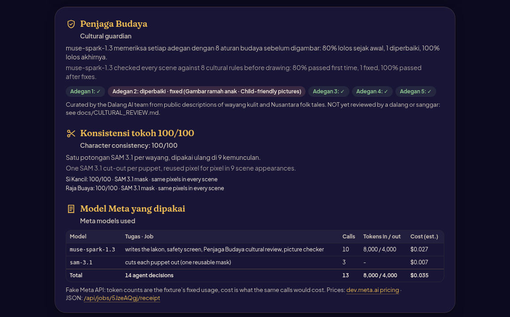
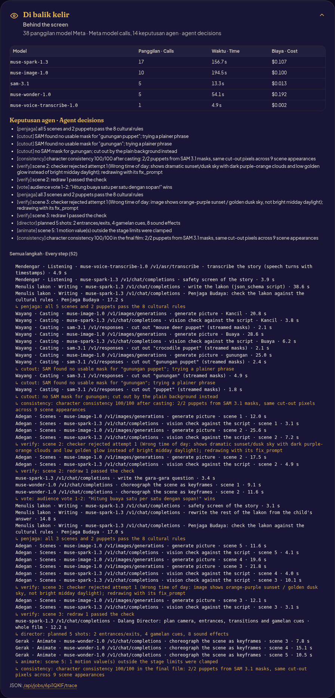
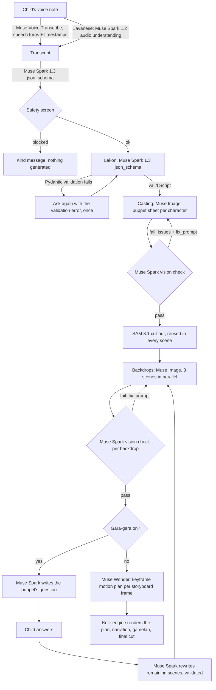

# How Dalang AI uses Meta models

One film takes **25 to 40 Meta model calls across six Meta models** (24 to 36 in the three live sample films), chained by an agent pipeline that validates,
checks, redraws and falls back by itself. Every call and every agent decision goes into the film's **agent trace**.
The app shows it under the storyboard and the player ("Di balik kelir · Behind the screen"), and
`GET /api/jobs/{id}/trace` serves it as JSON.

I checked every model id and endpoint below against Meta's docs (dev.meta.ai) on 2026-10-30 and 2026-10-31, and
against the live API on 2026-11-05 (see [VERIFICATION_REPORT.md](VERIFICATION_REPORT.md)). Only one module talks to Meta:
[`api/meta_client.py`](../api/meta_client.py). The prompts and JSON schemas live in [`api/prompts.py`](../api/prompts.py)
and are printed in full in [prompts.md](prompts.md).





## The pipeline as an agent loop



## Model by model

| Model (id) | Where | What it does in Dalang AI | Why this model | Beyond a single call |
|---|---|---|---|---|
| **Muse Voice Transcribe** (`muse-voice-transcribe-1.0`) | `POST /v1/asr/transcribe`, `ENDPOINTING` mode, `languageBias` + wayang `keywords` | Turns the child's recording into text, with speech-turn timestamps (`turns[].startMs/endMs`) | Native ASR, 25 languages incl. Indonesian and English | The turn timestamps cut the child's **own voice** into per-scene narration ("my own voice" mode) |
| **Muse Spark 1.2** (`muse-spark-1.2`) | `POST /v1/chat/completions` with an `input_audio` part | Transcribes **Javanese** stories | Javanese is not one of Voice Transcribe's 25 languages; Meta's docs recommend 1.2 for audio understanding | Routed automatically by story language |
| **Muse Spark 1.3** (`muse-spark-1.3`) | Chat completions with `response_format: json_schema` | 1. safety screen; 2. the **lakon** (title, moral, 1-4 characters mapped to wayang archetypes, 4-6 scenes with narration, backdrop prompt, motion prompt, staging, cultural notes); 3. the gara-gara question and the rewrite of the remaining scenes | Structured output gives a script shaped like the schema; my validation makes it one the renderer can trust | Every response is parsed into Pydantic models with ranges; an invalid script is sent back once with the validation error; a transcript-hash cache skips the call for a story told before |
| **Muse Spark 1.3 vision** (`muse-spark-1.3`, `VERIFY_MODEL`) | Chat completions with an `image_url` part + `json_schema` verdict `{passed, issues[], fix_prompt}` | Checks **every** puppet sheet and backdrop against the script: right subject, one puppet, empty backdrop, no text, wayang style, child-safe | Having a second model judge the first model's art keeps the film on-model | **Agentic redraw loop**: on a fail, the checker's own `fix_prompt` becomes the next Muse Image prompt, up to `MAX_VERIFY_RETRIES=2`; rejected pictures are kept and shown on the storyboard |
| **Muse Image** (`muse-image-1.0`) | `POST /v1/images/generations` (`reasoning_strength`, `tool_enablement` with image search on, web search and shell off) | One canonical puppet sheet per character (portrait, plain background), one empty kelir backdrop per scene, the gunungan | Flat wayang art direction in the prompt (sunggingan colours, tatahan perforation, never 3D or anime) | Backdrops are painted 3 at a time; a prompt-hash cache avoids paying twice; Kotak Wayang puppets skip it entirely |
| **SAM 3.1** (`sam-3.1`) | `POST /v1/responses`, streamed, `mask_encoding: one_bit`, parsed with Meta's `meta-sam-parser` | Cuts each puppet out of its sheet with a concept phrase from the script (`sam_phrase`, e.g. "mouse deer puppet") | Gives a transparent PNG, so the **same puppet** appears in every scene and in the printable PDF | Falls back to the phrase "puppet", then to a background key, and records the fallback in the trace |
| **Muse Wonder** (`muse-wonder-1.0`) | Chat completions with the storyboard frame as an image + `json_schema` motion plan | The dalang's hands: looks at each storyboard frame and returns keyframes per puppet (x, lift, angle, facing over t = 0..1), an idle motion, a camera move and lamp flicker | Meta's Model API has no video model; Wonder is the agentic model that plans, and my kelir engine performs the plan | Plans are clamped by Pydantic; a puppet the plan forgets gets a glide-in; an unusable plan falls back to rule-based motion (both recorded as decisions) |
| **Muse Spark Open** (open weights, `meta-models/muse-spark-open` on Baseten) | OpenAI-compatible chat, optional (`USE_OPEN_WEIGHTS=true`) | Writes the lakon instead of Muse Spark 1.3 | Runs the same structured-output pipeline on open weights | Same schema, same validation and retry |
| **Muse Glimmer** (open weights, `meta-models/Muse-Glimmer-30B` on Together AI) | OpenAI-compatible chat, optional | Safety screen and title/moral polish | Small open model for the cheap, frequent calls | Falls back from `json_schema` to `json_object` if a host lacks it; any failure keeps the original title |

Two parts don't come from Meta. Narration voices come from `api/tts.py` (edge-tts, plus Kokoro-82M for English
when it's installed), because Meta's Model API has no text-to-speech; how I picked them is in [VOICES.md](VOICES.md). And the video is rendered by my own engine (`api/pipeline/engine.py`), because Muse Wonder outputs
text (a motion plan) and no video.

## Penjaga Budaya: the cultural-review agent (Muse Spark 1.3)

After the lakon is written and before anything is drawn, `api/pipeline/penjaga.py` sends the script (characters
with archetypes and cultural notes; scenes with narration, action and image prompt) to `muse-spark-1.3` with the
rules from `content/cultural_rules.json` (8 rules: gentle-conflict, no-politics, no-gore, respect-figures,
kid-friendly-pictures, canon, no-invented-ritual, gunungan-respect, plus a canon list of 12 known characters).
Structured output (`json_schema` named `cultural_review`) returns per scene and per character `passed`, the rule ids
broken, an issue and fixed fields. Non-empty fixes are written into the script, so Muse Image only ever sees the
corrected prompts. A deterministic word scan of the same rules file runs before the call (as hints) and after it
(anything still matching gets the rules file's gentle words), so the guard still holds if the call fails.
Each finding and fix is an agent decision (`agent: penjaga`) in the trace, and the report (pass rate first time and
after fixes) is on the job and in `/api/jobs/{id}/receipt`. After a Gara-gara answer only the rewritten scenes are
reviewed. `CULTURAL_REVIEW=0` turns it off. I wrote the rules myself and they haven't been reviewed by a dalang yet.

## Character consistency score (SAM 3.1)

Consistency comes from segmentation. SAM 3.1 cuts each puppet out once and those pixels are reused in every scene. `api/pipeline/consistency.py` measures it per puppet, after casting and again after the final cut: mask
source (SAM mask 1.0, Kotak Wayang puppet 1.0, plain-background fallback 0.6), mask quality (silhouette fill and
soft-edge share), checker redraws of the character sheet (-0.15 each), and whether the cut-out file the renderer
used has the same SHA-256 as the one SAM produced. The film score is the mean, 0-100, shown under the film.

## Models receipt

`cost.receipt()` turns the trace into a per-film receipt: model, its job in Dalang AI, calls, images, tokens in/out
as the API reported them (`usage`), and the estimated cost from Meta's published prices
(https://dev.meta.ai/docs/pricing-rate-limits). Open-weight hosts are counted in tokens but not priced (they bill
separately). On the fake API the token counts are the fixture's fixed usage, and the receipt says that.

## The verify -> redraw loop in code

[`api/pipeline/verify.py`](../api/pipeline/verify.py), `make_verified()`:

1. Generate with Muse Image (`cached_generate`).
2. Ask Muse Spark vision for a `Verdict` (JSON schema `VERIFY_SCHEMA`, parsed into Pydantic `Verdict`).
3. If it passes, stop. If not: keep the rejected picture (shown on the storyboard with the checker's reason), write
   a decision to the trace, and redraw with the checker's `fix_prompt`.
4. After `MAX_VERIFY_RETRIES` failed redraws the last picture is kept and flagged, so the film still gets made.

The fake Meta API fails one check on purpose (scene 2: "a crocodile figure is painted into the backdrop, which must be
empty") so you can see the loop in tests, screenshots and the demo video.

## The agents on the live models (Nov 5)

From the traces of the sample films made with the live API (`content/samples/*/state.json`, "trace"):

* Kancil (Bahasa Indonesia): the Muse Spark 1.3 checker rejected the Kancil puppet sheet ("tip of tail is cropped at
  left edge") and the scene 3 backdrop ("Backdrop must be EMPTY ... image shows a row of crocodile backs"). Both
  redraws from its own fix prompt passed.
* Timun Mas (Basa Jawa): Penjaga Budaya changed three things before anything was drawn: the opening and closing
  scenes now show the gunungan, the ending stays a gentle chase where the giant gives up instead of sinking, and
  Buto Ijo was redrawn as grumpy rather than frightening ("Fangs and wide round eyes look frightening for ages
  5-12"). The checker then rejected the first Buto Ijo sheet as the wrong build and the redraw passed.
* SAM 3.1 cut out all 7 characters across the three films (the Golden Snail princess only after a re-cut with
  "person", see VERIFICATION_REPORT.md); the gunungan used the background fallback each time.

| Film | Muse Spark 1.3 | Muse Image | SAM 3.1 | Muse Wonder | Est. cost |
|---|---|---|---|---|---|
| Kancil | 12 calls, $0.050 | 2 calls (rest cached), $0.020 | 5 calls, $0.013 | 5 calls, $0.177 | $0.26 |
| Timun Mas | 12 calls, $0.057 | 9 calls, $0.090 | 10 calls, $0.025 | 5 calls, $0.184 | $0.36 |
| The Golden Snail Princess | 11 calls, $0.066 | 7 calls, $0.070 | 8 calls, $0.020 | 5 calls, $0.161 | $0.32 |

Narration is not a Meta call (Meta has no TTS), and transcription is not in this table because the sample films
start from typed stories. Muse Wonder is the biggest cost: each motion plan is a vision call with a long JSON answer.

## An agent trace on the fake API (Oct 31)

One film on the built-in fake Meta API (5 scenes, 2 characters, review off), 2026-10-31. Latencies are the fake
API's, so only the shape matters. Costs are what the same calls would cost at Meta's list prices (`api/cost.py`).
With a real key the same trace is recorded from the real responses.

| Model | Calls | Cost (USD) |
|---|---|---|
| muse-spark-1.3 (safety, lakon, 8 vision checks) | 10 | 0.027 |
| muse-image-1.0 (2 puppets, gunungan, 5 backdrops + 1 redraw) | 9 | 0.090 |
| muse-wonder-1.0 (5 motion plans) | 5 | 0.056 |
| sam-3.1 (2 puppets + gunungan) | 3 | 0.008 |
| **Total** | **27** | **0.180** |

The trace, in order (stage · model · purpose):

```
listen   muse-spark-1.3   safety screen of the story
lakon    muse-spark-1.3   write the lakon (json_schema script)
casting  muse-image-1.0   generate picture · Si Kancil
casting  muse-spark-1.3   vision check against the script · Si Kancil
casting  sam-3.1          cut out "mouse deer puppet" (streamed masks)
casting  muse-image-1.0   generate picture · Raja Buaya
casting  muse-spark-1.3   vision check against the script · Raja Buaya
casting  sam-3.1          cut out "crocodile puppet" (streamed masks)
casting  muse-image-1.0   generate picture · gunungan
casting  sam-3.1          cut out "gunungan puppet" (streamed masks)
scenes   muse-image-1.0   generate picture · scene 1 / 2 / 3   (3 in parallel)
scenes   muse-spark-1.3   vision check against the script · scene 2
  -> verify: scene 2: checker rejected attempt 1 (a crocodile figure is painted into the backdrop,
             which must be empty); redrawing with its fix_prompt
scenes   muse-spark-1.3   vision check against the script · scene 1, scene 3
scenes   muse-image-1.0   generate picture · scene 2            (the redraw, from the checker's fix_prompt)
scenes   muse-spark-1.3   vision check against the script · scene 2
  -> verify: scene 2: redraw 1 passed the check
scenes   muse-image-1.0   generate picture · scene 4 / 5
scenes   muse-spark-1.3   vision check against the script · scene 4 / 5
animate  muse-wonder-1.0  choreograph the scene as keyframes · scene 1 ... scene 5
```

Other decisions the trace records when they happen: `lakon` (script failed Pydantic validation, asked again),
`cache` (script or picture reused from the hash cache), `cutout` (SAM fallback), `animate` (plan repaired or
replaced), `kotak` (a family's puppet came back, no new drawing or cut), `penjaga` (a scene or puppet broke a
cultural rule and was fixed before drawing, or all passed), `consistency` (the film's character-consistency score).

## Guard rails around the models

Every call is priced (`api/cost.py`) and a film stops at `JOB_BUDGET_USD` (default $1.50; a normal film costs about
$0.15 to $0.30). 429 and 5xx responses are retried with back-off (2, 4, 8 s) and the attempts show up in the trace.
Nothing is drawn until the story passes the safety screen, and Gara-gara answers are screened too. A public link has
abuse limits on upload size, story length, recording length (trimmed to 120 s), new films per visitor per hour and
films in progress (`RATE_LIMIT_PER_HOUR`, `MAX_ACTIVE_JOBS`). Recordings are deleted after transcription (or after the
film, in "my own voice" mode).

## Go-live safety net

The first real key is the riskiest moment, so I built these to make it boring:

* Contract tests ([`api/contract.py`](../api/contract.py), `tests/test_contract.py`): every request
  `meta_client` builds during a whole film, Javanese listening, image edits and both open-weight hosts is checked
  against the documented request shapes, and every fake reply against the documented response shapes. Rules come
  only from Meta's docs: images endpoints (allowed top-level fields; "an unknown top-level field ... returns 400";
  edits take 1-10 `images` items with exactly one of `image_url`/`file_id`; aspect <= 16:1; `n` 1-10;
  https://dev.meta.ai/docs/image-generation, re-read 2026-11-02), chat structured output and image/audio parts
  (Spark 1.2 for audio, `max_tokens >= 4000`), ASR multipart, SAM 3.1 streamed `/v1/responses` with string metadata.
* Preflight: `python scripts/go_live.py --preflight` makes ONE cheapest call per model (1 s of audio, a tiny
  JSON chat on Spark 1.3 / 1.2 / Wonder, one low-reasoning image, one SAM cut-out; about $0.02) through a contract
  guard that refuses a malformed request locally, then prints a PASS/FAIL table with a plain-language fix per
  failure. `--preflight --dry-run` shows the same table on the fake API.
* Retries and a circuit breaker ([`api/resilience.py`](../api/resilience.py)): 429/5xx and timeouts retry with
  exponential back-off plus up to 25 % jitter (Retry-After honoured, capped at 30 s); after `BREAKER_THRESHOLD`
  (4) failed calls in a row a model's circuit opens for `BREAKER_COOLDOWN_S` (60 s) and calls fail fast. 4xx
  errors (e.g. a content-policy 400) never open it. Breaker states are in `GET /api/health`.
* Per-stage fallbacks: Muse Image down after its retries -> a picture labelled "PLACEHOLDER" (scene
  card and cast entry carry `placeholder: true`, the job lists `fallbacks`), never a crashed film; checker down ->
  picture kept unchecked; Muse Wonder down -> rule-based motion (existing); SAM down -> background key (existing).
* Hard spend caps: `MAX_USD_PER_FILM` (alias of `JOB_BUDGET_USD`, default $1.50) and `MAX_USD_TOTAL`
  (default $25, persisted in `DATA_DIR/spend_total.json`, counts only real calls). Checked before every paid call.
* Recorded fixtures: `META_RECORD_DIR=fixtures/` records each exchange (no keys; images and audio replaced by
  their hash in the request record); `META_REPLAY_DIR=fixtures/` replays them with no network and no cost (exact
  match, then same endpoint + model + schema). Record once on go-live day and every rehearsal after is free.

## Dalang Director (Muse Spark 1.3)

Before the motion plans, [`api/pipeline/director.py`](../api/pipeline/director.py) asks `muse-spark-1.3` (json_schema
`director`, prompt in `api/prompts.py`) to direct the whole film shot by shot, like a dalang leading the gamelan:
per scene a **camera move** (still, push in, pull out, pan, tilt), which **puppets enter or exit and from which side**,
the **transition** into the next scene (gunungan sweep, gunungan rise, fade, cut), a **gamelan cue** (gong, kempul,
kendang rush, bonang run, suwuk) and up to three **sound effects** (keprak, cempala, gong, wind, water, birds).
The answer is validated with Pydantic: unknown puppets and scene numbers are removed, a missing scene gets a
rule-based shot, the last shot always fades (each repair is a `director` decision in the trace); if the call fails
the whole plan is rule-based. The kelir engine performs it on top of Muse Wonder's keyframes (entrances and exits
are extra keyframes around Wonder's own; the camera move replaces Wonder's), and the soundtrack plays the cues.
`GET /api/jobs/{id}/director` returns the plan.

## Remix (Muse Spark 1.3)

`POST /api/jobs/{id}/remix {"language": "id|jv|en", "pov": "original|villain"}` re-tells a finished film in another
language or in the villain's own voice. The new film copies the original's puppets (SAM cut-outs), backdrops, motion
plans and Director plan; one Muse Spark call (json_schema `remix`) rewrites title, moral, opening and every scene's
narration for the same scenes, Penjaga Budaya reviews the new words, then narration and the final cut run. No
Muse Image, SAM or Muse Wonder call is made, so a remix costs a fraction of the original (see EVAL_REPORT.md).

## Open weights per stage

With `USE_OPEN_WEIGHTS=true`, `OPEN_WEIGHTS_STAGES` (default `lakon`) chooses which text-only structured-output
stages run on Muse Spark Open on Baseten (`meta-models/muse-spark-open`, model string from
https://dev.meta.ai/docs/muse-spark-open/deploy#baseten): any of `lakon, director, remix, cultural_review, gara_gara,
gara_gara_rewrite`. Picture checks (vision) and Muse Wonder motion plans stay on Meta's API. I haven't tested this
live (no Baseten key yet). The eval's open-weights table only covers fake-mode plumbing, and it says so.

## Parts that aren't Meta models

* The **gamelan score** is procedural code ([`api/pipeline/gamelan.py`](../api/pipeline/gamelan.py)): slendro and
  pelog tunings (textbook approximations; real sets differ), a balungan line per mood on saron, bonang, colotomic
  kenong/kempul/kethuk/gong and kendang patterns, rendered with numpy. `GET /api/gamelan/{mood}.wav` previews it.
* The **aksara Jawa title** is a rule-based Latin -> Hanacaraka transliterator ([`api/aksara.py`](../api/aksara.py))
  drawn with Noto Sans Javanese (SIL OFL 1.1, `content/fonts/`).
* **Stickers and GIF** (`/api/jobs/{id}/stickers`, `.zip`, `/loop.gif`) are made from the film's own SAM cut-outs
  and video: WhatsApp-ready 512x512 transparent WebP under 100 KB plus a 96x96 tray icon.
* The **audience vote** (`/api/jobs/{id}/vote`, `/vote/close`) lets a family or classroom choose the gara-gara
  branch from their phones; the winning option goes through the same answer path (safety screen, Muse Spark rewrite).
* **Kelir Live** (`/kelir/{id}`) is browser code (canvas + pointer events): it performs the film's own SAM 3.1
  cut-outs and Muse Image backdrops by hand, with no model call. The **pipeline theatre** on the film page only shows
  the agent trace that the pipeline already writes, as six troupe members (five Meta models plus the Penjaga
Budaya agent on Muse Spark 1.3, each on its own lit kelir); it makes no extra calls.

## Numbers for the Nov 1-2 additions (fake Meta API, Nov 2)

All measured on the fake API, so they test my code, not Meta's model quality: Director plans
valid for 6/6 films, gamelan 14/14 renders, Remix 3/3 done at a mean 6% of the original film's estimated cost,
audience vote applied, failure tests 100% completed when one stage fails once, 67% when it fails always, 100% handled
gracefully; `make preflight-dry` 6/6 PASS ([EVAL_REPORT.md](EVAL_REPORT.md), [GO_LIVE.md](GO_LIVE.md)).
