# Demo video storyboard

Generated by `scripts/demo_storyboard.py` from `dalang-ai-demo.mp4` (177.9 s). One still per shot, taken mid-shot.

| # | Time | Shot | Still | Voice-over |
|---|---|---|---|---|
| 1 | 0:00.0-0:03.2 | voice | 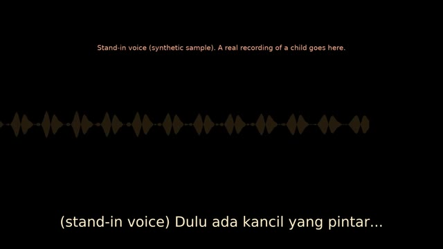 | (the child tells the story) |
| 2 | 0:03.2-0:10.2 | opening |  | (film plays with its own narration and gamelan) |
| 3 | 0:10.2-0:29.2 | film1 | 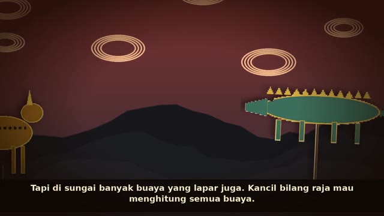 | That's a kid's story. Ninety seconds of talking, performed back as wayang kulit. |
| 4 | 0:29.2-0:42.2 | garagara | 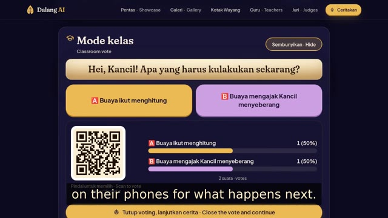 | Then the gara-gara. The show pauses and the whole class votes on their phones for what happens next. |
| 5 | 0:42.2-0:57.2 | film2 | 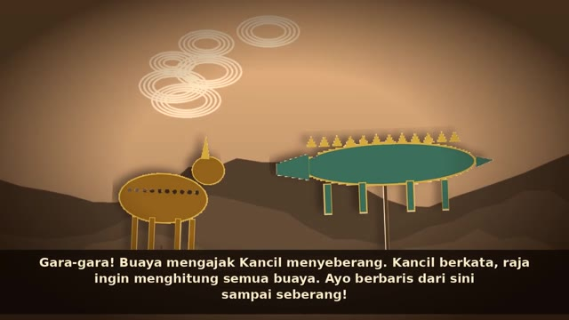 | (film plays with its own narration and gamelan) |
| 6 | 0:57.2-1:15.2 | kelir | 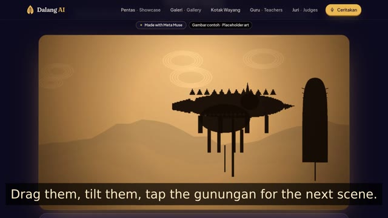 | Then the child takes the puppets. In Kelir Live they're on a lamp-lit screen. Drag them, tilt them, tap the gunungan for the next scene. |
| 7 | 1:15.2-1:26.6 | why | 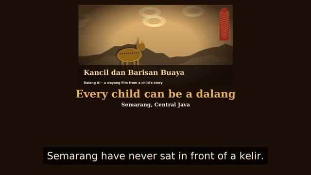 | Wayang is a thousand years old, but most kids around Semarang have never sat in front of a kelir. With Dalang AI, every child gets to be the dalang. (Malik, first person: I'm Malik, from Semarang. Wayang is a thousand years old, but the kids around me have never sat in front of a kelir. So I built Dalang AI.) |
| 8 | 1:26.6-1:37.6 | landing | 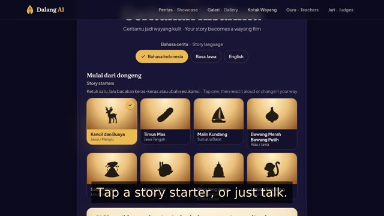 | Any child can tell a story in Indonesian, Javanese or English. Tap a story starter, or just talk. Nothing to type. |
| 9 | 1:37.6-2:07.7 | progress | 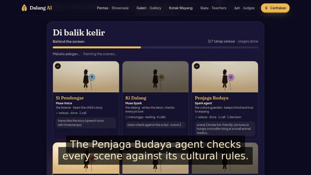 | Six Meta models work as one troupe, and you can watch them on stage. Muse Voice Transcribe listens, Muse Spark one point two hears Javanese, and Muse Spark one point three writes the lakon. The Penjaga Budaya agent checks every scene against its cultural rules. Muse Image carves each puppet once and SAM three point one cuts it out. Muse Wonder plans every move, and the Dalang Director sets the camera and the gamelan. |
| 10 | 2:07.7-2:21.8 | trace | 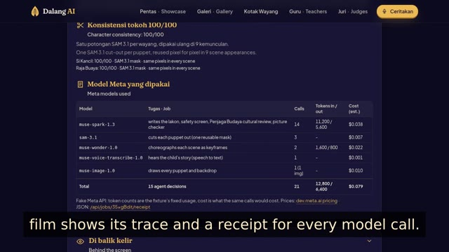 | It checks its own work. A vision agent redraws any picture that breaks the script, and every film shows its trace and a receipt for every model call. |
| 11 | 2:21.8-2:37.8 | share | 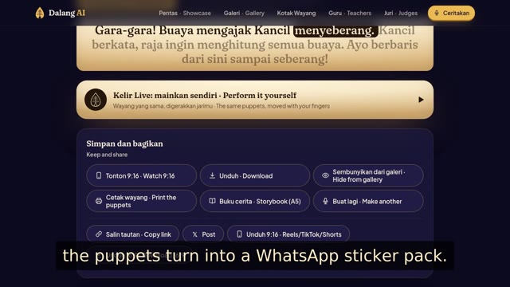 | Read-along captions light up each word as it's spoken. Share the film to the Pentas wall, and the puppets turn into a WhatsApp sticker pack. |
| 12 | 2:37.8-2:45.8 | print | 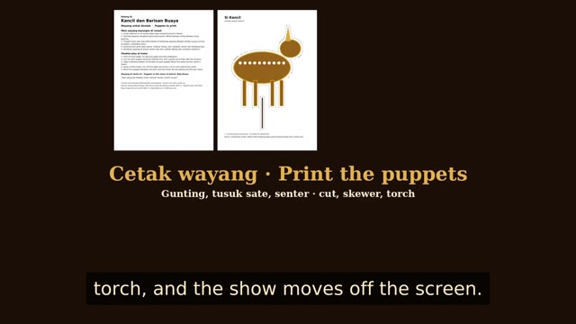 | Print the puppets and the storybook, grab a torch, and the show moves off the screen. |
| 13 | 2:45.8-2:57.9 | close | 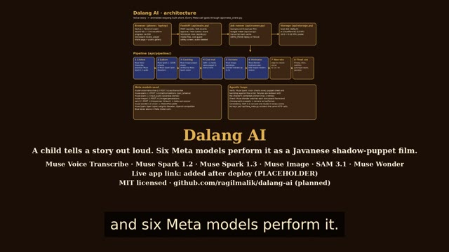 | Dalang AI. A child tells a story out loud, and six Meta models perform it. Every child can be a dalang. (Malik, first person: Built solo this week with Meta's models. Dalang AI: every child can be a dalang. Matur nuwun.) |
